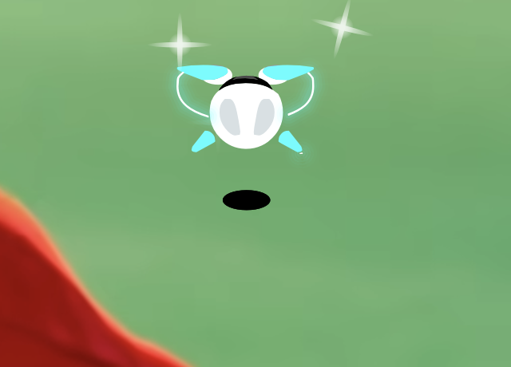
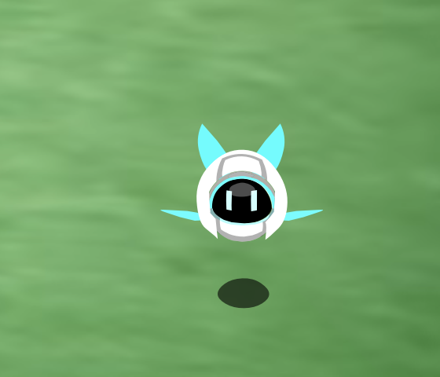
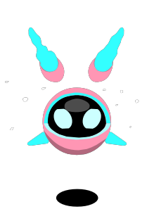

# 超能 NONO 桌宠

把赛尔号的超能 NONO 放到桌面上：透明置顶、可拖拽、会自己走动、能播放原版动作与音效。
用 Rust + winit + ThorVG 实现，常驻内存约 **20 MB**，待机不重绘。

> 当前进度：**M1（桌宠核心）已完成**，macOS 可运行。插件与 Agent 的协议/接口已就位，
> 具体运行时分别在 M3 / M2 实现。





## 功能（M1）

- 无边框、透明、始终置顶的宠物窗口，不占 Dock（macOS Accessory 策略）。
- 形态 1–4 的全部素材：八方向走路、动作（形态 3/4 没有「充电」）、表情、动作音效。
- 按 `petAnchor` 对齐，切换动画时宠物在屏幕上不跳位。
- 拖拽移动；单击做表情；右键做随机动作；托盘菜单切换动作 / 表情 / 形态 / 大小 /
  速度 / 音效 / 自由走动 / 隐藏 / 退出。
- 屏幕边缘硬限制：按宠物轮廓计算安全区，拖到屏幕边也拖不出去，轮廓不会被裁。
- 「跟随鼠标（20 秒）」：托盘点一下，NONO 会朝鼠标方向走过去，20 秒后自动停下。
- 调色盘：托盘「颜色」可把白色外壳换成樱花粉/柠檬黄/薄荷绿/天空蓝/葡萄紫/蜜橙/珊瑚红，
  渲染层换色、不改素材，随时可还原默认白。只染素材里带 `nono.dye` 标签的填充：`solid`
  染成实色（本体白、耳根白），`shade` 按亮度染成较深色（灰色阴影）；没有标签的（青色、
  面罩、眼睛、道具、白色闪光特效）永远不动，带关键帧的颜色会保留原来的明暗动画。
  颜色写入配置，重启保留。
- 静止时原地循环播放走路动画（和原客户端一致），托盘可关掉以省电。
- 行走残影：按「间隔」定时生成帧快照，每个残影在「停留时间」内独立淡入淡出，
  整体自然形成由深到浅的尾巴；方向改变和跟随鼠标时同样生效。三项参数都可自定义：
  - 间隔 20–400 毫秒（控制疏密，默认 120）
  - 停留时间 100–1600 毫秒（控制长度，默认 640）
  - 浓度 2%–60%（控制强度，默认 22%）

  托盘「残影」里可以用 ± 按钮细调、恢复默认、打开 `config.toml` 直接改数值；
  打开配置后会自动开启「自动重载配置（调试）」，保存文件即可实时看到新参数，不用重启。
  地面阴影不会进入残影。
- 移动速度：托盘「速度」可设全局速度（10–400 pt/s，±10 微调），并可分别覆盖
  「跟随鼠标」和「待机自由移动」的速度；没有设置覆盖时直接使用全局速度。
  默认保留原来的手感：全局 60 pt/s，自由移动用全局，跟随为 140 pt/s
  （菜单里勾上「跟随使用全局速度」即可让跟随也用全局）。速度也支持配置热重载。
- 关机播完后，有充电动画的形态（1/2）会继续循环充电；形态 3/4 停在关机末帧。
- 待机时偶尔自己走一段、换个朝向或做个表情（可关闭）。
- 窗口跟随动画画布动态缩放；只有 NONO 的圆形身体接受点击/拖动，耳朵、鳍、道具和
  透明区域全部点击穿透；动作播放期间窗口整体穿透，不挡桌面。
- 素材包从 1.0.0 起做版本管理：版本/变更见 `assets/asset-version.json`、`assets/CHANGELOG.md`，
  更新流程见 `docs/ASSET_VERSIONING.md`；`nono --check` 会打印素材版本。
- 配置持久化：形态、缩放、音量、漫游开关、移动速度、残影开关/间隔/停留/浓度、屏幕位置。
- 全 JSON 事件总线，`--trace` 可看到所有事件。
- 送一个 `--render-frame` / `--render-icon` 小工具，方便导出素材帧和图标。

## 快速开始

前置：Rust 1.80+（本机用 rustup 安装），macOS 需要 Xcode Command Line Tools（提供 C++ 编译器与 libclang）。

```bash
rustup default stable
export PATH="$HOME/.cargo/bin:$PATH"   # 如果 cargo 还不在 PATH 里
cargo run --release -p nono-app
```

首次编译会从源码构建 ThorVG，约 1 分钟。

国内网络可先设置镜像：

```bash
export RUSTUP_DIST_SERVER=https://rsproxy.cn
export RUSTUP_UPDATE_ROOT=https://rsproxy.cn/rustup
```

常用参数：

```bash
cargo run --release -p nono-app -- --check        # 校验素材与 catalog
cargo run --release -p nono-app -- --list         # 列出动作/表情
cargo run --release -p nono-app -- --trace        # 打印事件与调试日志
cargo run --release -p nono-app -- --play action:1:cube   # 启动即播放某个动画
cargo run --release -p nono-app -- --render-frame 1 action cube 100 3 /tmp/cube.png
cargo run --release -p nono-app -- --render-icon assets/icon/nono-tray.png 64
```

`NONO_ASSETS` 可覆盖素材目录，`NONO_CONFIG` 可覆盖配置文件路径，`NONO_CACHE` 可覆盖染色缓存目录（便携/测试用）。

## 交互一览

| 操作 | 行为 |
|---|---|
| 左键单击 | 随机表情（60% 概率优先「开心」） |
| 左键拖拽 | 移动 NONO，松手后记住位置 |
| 右键单击 | 随机动作 |
| 托盘菜单 | 动作 / 表情 / 形态 / 颜色 / 大小 / 速度（全局·跟随·自由移动） / 残影（开关·间隔·停留·浓度·配置热重载） / 音效 / 自由走动 / 静止时播放走路 / 跟随鼠标（20 秒） / 隐藏 / 退出 |

配置与窗口位置保存在 `~/Library/Application Support/NonoPet/config.toml`。

### 调参（残影 / 速度）

托盘「残影」→「打开配置文件…」会在默认编辑器里打开 `config.toml`，并自动开启
「自动重载配置（调试）」。直接改下面这些行、保存即可实时生效：

```toml
trail_enabled = true
trail_interval_ms = 120
trail_lifetime_ms = 640
trail_opacity = 0.22

move_speed = 60.0
follow_speed = 140.0
idle_speed = 80.0
form1_walk_anim_speed = 1.0
```

- `trail_interval_ms`：20–400，越小残影越密
- `trail_lifetime_ms`：100–1600，越大尾巴越长（会被 `间隔 × 48` 限制，避免内存失控）
- `trail_opacity`：0.02–0.60，越大越显眼
- `move_speed`：10–400 pt/s，全局移动速度
- `follow_speed`：跟随鼠标的速度；**删掉这一行**（或注释掉）就跟随全局
- `idle_speed`：待机自由移动速度；删掉这一行就跟随全局
- `form1_walk_anim_speed`：0.25–4.0，形态 1 八个方向走路/待机动画的**播放速度倍率**
  （1.0 = 原始 25fps；只影响动画循环，不影响移动速度，配置热重载即时生效）

默认值是 `move_speed = 60`、`follow_speed = 140`、`idle_speed` 不设置（跟全局）。
旧版配置第一次加载会自动补上 140 的跟随速度，保持原来的手感；一旦配置里出现
任意 `move_speed` / `follow_speed` / `idle_speed`，省略 `follow_speed` 就表示跟随全局。
想用一个全局速度统一控制，把 `follow_speed` 删掉，或在托盘「速度」里勾选
「跟随使用全局速度」。

残影长度本质上是「速度 × 停留时间」，所以调快速度也会让尾巴按比例变长。
极端组合下透明舞台每侧最多扩 700 物理像素，超出的最老残影会被裁掉，避免卡顿。
托盘里的 ± 按钮可以快速微调并立即写回配置；「预览一次（走一小段）」会按
自由移动速度马上走一段，不用等下一次自由走动就能看效果。
调完可以关掉「自动重载配置（调试）」，平时它不会轮询文件。

## 工程结构

```
assets/                  原始 Lottie 素材 + catalog.json + 托盘图标
crates/nono-core/        事件总线、状态机、行为调度、素材目录、配置、速度/残影参数
crates/nono-render/      ThorVG 软件光栅 + Lottie 播放（共享 picture、内存回收）
crates/nono-platform/    透明呈现（macOS CALayer）、托盘、NSSound、窗口
crates/nono-app/         主程序与 CLI
crates/nono-plugin/      插件契约（manifest / 权限 / 宿主 trait，M3 落地）
crates/nono-agent/       Agent 协议 + Adapter trait + Mock（M2 落地）
tools/build_catalog.py   把各目录 manifest 归一化成 catalog.json
docs/                    架构、素材契约、插件规范、Agent 协议
```

更细的设计见 [docs/ARCHITECTURE.md](docs/ARCHITECTURE.md)。

## 性能（本机 macOS 15.7 / 5K 屏 / release）

| 场景 | 数据 |
|---|---|
| 待机内存（footprint） | ~24 MB |
| 待机 CPU（静止播放走路） | 约 4%（1.5 ms/帧 × 25fps），托盘可关 |
| 关闭「静止时播放走路」后 | 不重绘、无定时器，≈0 |
| 最大动作（形态 2 玩球，2631×1440 物理像素） | ~68 MB，帧耗时 ~18 ms（25 fps） |
| 大动作结束回到待机 | ~25 MB（主动归还分配器页） |
| 走路窗口 | 99×144 pt，帧耗时 ~1.5–1.8 ms |
| 走路 + 残影（默认 120/640 ms） | 舞台 178×223～281×326 pt；25 fps 全量 ~1.2–2.5 ms，另按屏幕刷新节奏缓存重合成 ~2 ms/帧（消除长残影抖动） |
| 形态 2 魔方（染色，冷缓存） | 首次加载 ~0.38 s，之后走缓存 ~0.1 s；从第 0 帧开始播放 |
| 反复切换动作 | 内存回到 ~25–30 MB 基线，不再随点击次数增长 |

残影开启时，走路期间会按约 60 fps 重新合成残影层，避免窗口移动与 25 fps 动画不同步
造成的抖动；因此走路爆发时 CPU 会比关闭残影高（默认档约 10% 单核），待机时仍是 0。
长残影（例如 1600 ms）重合成会到 ~3 ms/帧，觉得费电可以缩短停留时间或关闭残影。

染色大动作首次播放需要先解析并生成染色缓存；期间画面会短暂停在上一帧，加载完成后
会暂停计时并从第一帧开始播放（不会出现“只剩最后一帧”）。缓存位于
`~/Library/Caches/NonoPet/tinted`，换颜色时会清空；可用 `NONO_CACHE` 覆盖位置。

## 测试

```bash
cargo test --workspace
python3 tools/build_catalog.py --check
```

测试覆盖：素材目录完整性、petAnchor 对齐数学、走路/动作/表情状态迁移、
`auto_end=0` 停末帧、行为调度、事件 JSON 形状、ThorVG 帧推进与切换、
速度覆盖/全局回退、残影间隔/停留/浓度曲线、地面阴影剔除与预乘 alpha 合成、
染色 JSON 的 key 顺序保持与加载时钟补偿。

## 路线图

- **M2**：气泡 UI + Agent 对话（剪贴板触发；Mock/Ollama/OpenAI 兼容适配器；情绪→表情映射）。
- **M3**：wasmi 插件宿主（权限白名单、fuel 限额、热加载）+ 示例插件（整点报时）。
- **M4**：用户素材导入（图片帧 / 视频转精灵帧）、插件与素材市场、Windows/Linux 呈现后端。

## 已知限制

- 仅 macOS 有透明呈现后端；Windows/Linux 需要各自的 `Presenter` 实现。
- 点击区域是 NONO 的圆形身体（按调色后的身体色相，或未调色时的白/灰本体计算），
  耳、鳍、道具、透明区点击穿透；大动作播放期间窗口整体不接收点击。
- 开启残影走路时，窗口会为了残影临时加上透明边距；透明区域点击穿透，鼠标移到
  NONO 本体上会自动恢复可点击/拖动。停下后残影还会淡出到「停留时间」结束，
  窗口才缩回。
- 拖动期间和松手后的 6–16 秒内不会触发自由走动；拖动时宠物也不会再被待机调度
  带跑。
- 残影调到很长/很浓时，走路窗口、内存和帧耗时都会相应变大（最长档跟随速度下
  舞台约 549×594 pt）；觉得卡就调短停留时间或调大间隔。
- 超大动作窗口会裁剪到主屏可用区域（菜单栏/Dock 之外），保证角色不被窗口钳位带偏；
  多显示器时暂按主屏计算。
- 素材目前全是 Lottie；用户上传 / 视频转精灵帧的流水线尚未开工。
- 图标由 `nono --render-icon` 生成，尚未打包成 `.app` 与 `.icns`。

## 素材与许可

`assets/` 中的动画与音效来自项目提供的《超能 NONO》资源包，版权归原权利方所有，
仅供学习与个人桌面使用。代码部分为 MIT。
